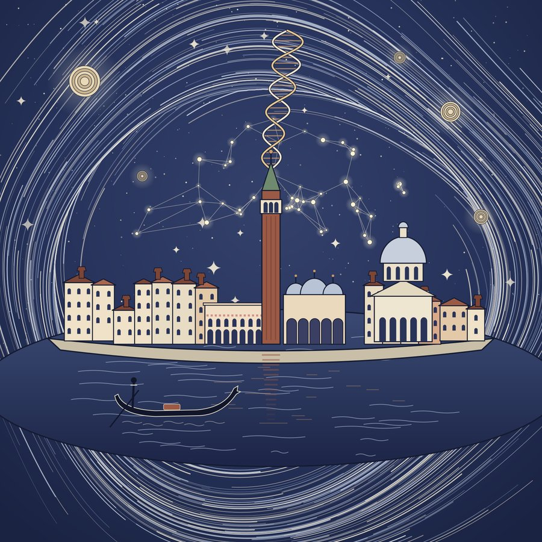

<header class="hero">
  

    

      
      
      
    

    
PhD in Science and Technology for Advanced Therapies

    <h1>STAT MD-WORKSHOP</h1>
    

      
      

        
Science, Rewired

        
How AI Is Transforming the Way We Do Research

        
2–4 DECEMBER 2026

        
Venice International University

        <a class="btn" href="assets/Programme_STAT-MD-Workshop_2026.pdf">Download the programme (PDF)</a>
        
<strong>SCIENTIFIC COMMITTEE</strong>Prof. Annalisa Bonfiglio · Prof. Christian Salvatore · Prof. Raffaella Di Micco · Prof. Federico Forneris

      

    

  

</header>

<nav aria-label="Sections">
  <ul>
    <li><a href="#workshop">The Workshop</a></li>
    <li><a href="#programme">Programme</a></li>
    <li><a href="#ai-canvas">AI Canvas</a></li>
    <li><a href="#committee">Scientific Committee</a></li>
    <li><a href="#speakers">Speakers</a></li>
    <li><a href="#information">Information</a></li>
  </ul>
</nav>

<main>
<section id="workshop">
<h2>The Workshop</h2>

<b>Aims</b>objectives and learning outcomes

The PhD in Science and Technology for Advanced Therapies (STAT) MD-Workshop brings together doctoral students from the three curricula of the programme – Hadron Therapy and Advanced Biophysical Therapies, Gene and Cell Therapies, and Biomolecular and Biotechnological Sciences – to explore how artificial intelligence is changing the way research is designed, carried out and communicated, through expert talks, hands-on activities and group work.

Objectives

<ol class="obj">
<li><strong>Build a common language</strong>Provide a shared vocabulary and conceptual framework on artificial intelligence for PhD students from different scientific backgrounds.</li>
<li><strong>Explore AI across the life sciences</strong>Show, through talks by academic and industry researchers, how AI is reshaping biotechnology, neuroscience, genomics, plant bioinformatics, genome editing and drug discovery.</li>
<li><strong>Promote responsible use</strong>Encourage a critical and responsible approach to AI tools, including large language models, focusing on reliability, trust and the researcher’s accountability.</li>
<li><strong>Bridge academia and industry</strong>Offer an industrial perspective on how AI-driven research moves from discovery to real-world applications.</li>
<li><strong>Foster interdisciplinary collaboration</strong>Create opportunities for exchange and networking through group work, poster sessions and informal moments.</li>
</ol>

Learning outcomes

By the end of the Workshop, participants will be able to:

<ul class="out">
<li>describe the main applications of AI and machine learning in the research areas covered by the programme;</li>
<li>critically assess the outputs of AI tools, including LLMs, recognising their limitations, risks and the need for validation;</li>
<li>identify where AI can add value to a research problem and outline an AI-based approach, from data to validation;</li>
<li>present their research and ideas clearly to an interdisciplinary audience through posters, lightning talks and short pitches;</li>
<li>work effectively in interdisciplinary teams and build a network of peers, academics and industry professionals.</li>
</ul>

</section>

<section id="programme">
<h2>Programme</h2>

<b>Three days</b>talks, hands-on activities and networking

<h3 class="day-title">Day 1– December 2, 2026 – Afternoon</h3>

<b>Theme</b>building a common language

<table>
<thead><tr><th scope="col">Time</th><th scope="col">Activity</th><th scope="col">Instructor/Speaker</th><th scope="col">Description</th></tr></thead>
<tbody>
<tr><td>13:30–14:15</td><td>Registration and poster setup</td><td>—</td><td>Welcome of participants, distribution of materials, and poster setup.</td></tr>
<tr><td>14:15–14:30</td><td>Welcome and introduction</td><td>—</td><td>Presentation of the objectives, program, and participation format.</td></tr>
<tr class="talk"><td>14:30–15:30</td><td>AI, innovation and the future of research</td><td>Stefano Bertacchi, PhDIndustrial Biotechnologist and Science Communicator, University of Milano-Bicocca</td><td>Title:Rethinking research in the AI era: innovation through the lens of biotechnology45-minute talk + 15-minute Q&amp;A</td></tr>
<tr class="talk"><td>15:30–16:30</td><td>Translational AI in neuroscience</td><td>Antonio Cerasa, PhDNeuroscientist, Head Neuroimaging Lab, IBSBC-CNR; former Director of the Department of Biomedical Sciences, National Research Council of Italy (CNR)</td><td>Title:From brain imaging to clinical impact: AI and translational neuroscience45-minute talk + 15-minute Q&amp;A</td></tr>
<tr class="break"><td>16:30–16:50</td><td>Coffee break</td><td>—</td><td>Break and first opportunity for informal networking.</td></tr>
<tr class="talk"><td>16:50–17:50</td><td>AI and genomic medicine</td><td>Gennaro GambardellaTenure-track Researcher in Bioengineering, Scuola Superiore Meridionale; Group Leader, Telethon Institute of Genetics and Medicine (TIGEM), Naples</td><td>Title:Beyond Pathogenicity: Can AI Tell Us What Genetic Variants Actually Do?45-minute talk + 15-minute Q&amp;A</td></tr>
<tr class="facil"><td>17:50–18:10</td><td>Icebreaker + group formation and mini-challenge kickoff</td><td>Facilitators:Dr. Stefano BertacchiProf. Christian Salvatore</td><td>Guided activity to help participants get to know one another while also forming the groups that will work together the following day. Each group selects a research case/problem to use in the Day 2 hands-on activities and identifies an initial question to develop.</td></tr>
<tr class="break"><td>18:10–18:30</td><td>Welcome reception</td><td>—</td><td>Informal networking among PhD students, speakers, and organizers.</td></tr>
</tbody></table>

<h3 class="day-title">Day 2– December 3, 2026 – Morning and afternoon</h3>

<b>Theme</b>applications, responsibility and networking

<table>
<thead><tr><th scope="col">Time</th><th scope="col">Activity</th><th scope="col">Instructor/Speaker</th><th scope="col">Description</th></tr></thead>
<tbody>
<tr><td>09:00–09:15</td><td>Recap and introduction</td><td>—</td><td>Summary of Day 1, review of the cases selected by the groups, and presentation of the day’s operational objectives.</td></tr>
<tr class="talk"><td>09:15–10:15</td><td>Applied AI and Bioinformatics</td><td>Elena Del PupBioinformatics PhD Candidate,Wageningen University &amp; Research</td><td>Title:Unlocking the Plant Bioeconomy: Data-Driven Discovery of Plant Natural Products45-minute talk + 15-minute Q&amp;A</td></tr>
<tr class="facil"><td>10:15–11:15</td><td>Exercise 1 – Responsible use of LLMs</td><td>Facilitator:Prof. Christian Salvatore</td><td>Guided activity on prompting, response verification, limitations, and potential applications in research. Groups work on the case selected on Day 1 and produce an initial output draft to verify and improve. Duration: 60 minutes.</td></tr>
<tr class="break"><td>11:15–11:35</td><td>Coffee break</td><td>—</td><td>Break and networking.</td></tr>
<tr class="talk"><td>11:35–12:35</td><td>Responsible trust in AI</td><td>Alessio Tacca, PhDEpistemologist. Postdoctoral researcher and member of the ODD research team at Università San Raffaele, Milan.</td><td>Title:Can we trust AI in science? Evidence, fallibility and responsibility45-minute talk + 15-minute Q&amp;A</td></tr>
<tr class="break"><td>12:35–13:45</td><td>Lunch break</td><td>—</td><td>Lunch and informal networking.</td></tr>
<tr><td>13:45–14:15</td><td>Poster lightning talks</td><td>—</td><td>Three participants, selected by the Workshop’s Scientific Committee, each deliver a 5-minute talk introducing their research question and the key findings or ideas presented in their poster, followed by 3 minutes of questions and discussion. The session encourages further exchange during the poster session.</td></tr>
<tr><td>14:15–15:00</td><td>Poster session</td><td>—</td><td>Discussion of projects, collection of feedback, and identification of potential collaborations.</td></tr>
<tr class="break"><td>15:00–15:20</td><td>Coffee break and networking</td><td>—</td><td>Break dedicated to open discussion and further development of connections made during the event.</td></tr>
<tr class="facil"><td>15:20–16:10</td><td>Workshop – AI Canvas &amp; rapid prototyping</td><td>Facilitator:Prof. Christian Salvatore</td><td>Guided workshop in which groups develop the case selected on Day 1, defining the problem, users/decision, data, expected output, and success criteria. A short rapid-prototyping phase using accessible tools (no-code, visual workflow, or LLM, depending on the case) is used to test one element of the proposal in practice. The work concludes by identifying limitations, risks, and the next experiment needed to validate the idea.</td></tr>
<tr class="facil"><td>16:10–16:55</td><td>Final group pitches and results</td><td>Facilitator:Prof. Christian Salvatore</td><td>Each group of approximately five participants delivers a 4-minute presentation of its AI Canvas and hands-on results, highlighting the research problem, proposed solution, required data, preliminary output, main limitation, and next validation step. Each presentation is followed by 2 minutes of questions and feedback from facilitators and participants. The session accommodates up to seven groups.</td></tr>
<tr><td>16:55–17:00</td><td>Closing of the day</td><td>—</td><td>Summary of the main takeaways and conclusion of the hands-on component of the Workshop.</td></tr>
<tr class="break"><td>17:00–evening</td><td>Dinner on San Servolo &amp; free evening</td><td>—</td><td>Dinner together on the island of San Servolo, followed by free time to enjoy Venice at your own pace.</td></tr>
</tbody></table>

<h3 class="day-title">Day 3– December 4, 2026 – Morning</h3>

<b>Theme</b>industrial perspective and closing

<table>
<thead><tr><th scope="col">Time</th><th scope="col">Activity</th><th scope="col">Instructor/Speaker</th><th scope="col">Description</th></tr></thead>
<tbody>
<tr><td>09:00–09:10</td><td>Opening of the day</td><td>—</td><td>Brief introduction to the final program and review of the main results from the first two days. No new hands-on activities.</td></tr>
<tr class="talk"><td>09:10–10:10</td><td>AI and genome editing</td><td>Ilaria BonuzziLaboratory of Advanced Genome Editing Technologies, Department CIBIO, University of Trento</td><td>Title:Smart-Editors: Tailoring Genome Editing Enzymes with Artificial Intelligence45-minute talk + 15-minute Q&amp;A</td></tr>
<tr class="talk"><td>10:10–11:10</td><td>Industrial talk 1</td><td>Piero NeriComputer Scientist at PhilochemSamuele CazzamalliHead of Research at Philochem</td><td>Title:Encoded Libraries and Machine Learning for the Discovery of Tumor-Targeted Ligands45-minute talk + 15-minute Q&amp;A</td></tr>
<tr class="break"><td>11:10–11:30</td><td>Coffee break</td><td>—</td><td>Short break and informal networking.</td></tr>
<tr class="talk"><td>11:30–12:30</td><td>Industrial talk 2</td><td>Ilaria RochelliData Scientist, Generali Italia</td><td>Title:From Prompts to Production: Generative AI in Insurance Claims45-minute talk + 15-minute Q&amp;A</td></tr>
<tr><td>12:30–12:40</td><td>MD-Workshop closing</td><td>—</td><td>Overall summary of results, take-home messages, final feedback, and pointers to resources and follow-up activities.</td></tr>
</tbody></table>

</section>

<section id="ai-canvas">
<h2>AI Canvas</h2>

<b>Student materials</b>group activity and final pitches

In groups of about five, you will turn a real research problem into a one-page proposal for using AI and present it in a short pitch. Nothing has to be built or coded: the aim is to think clearly about the problem, the data and how you would know the idea works.

Before the Workshop
Think of a possible case from your own research.

Day 1 · 17:50–18:10
Form your group, choose one case and write an initial question.

Day 2 · 15:20–16:10
Fill in the nine blocks of the AI Canvas and prepare your pitch.

Day 2 · 16:10–16:55
Present your canvas: 4 minutes, followed by 2 minutes of questions.

<h3 style="margin-top:30px">Download</h3>

<a class="dl" href="assets/ai-canvas/AI-Canvas_Student-Guide-and-Worksheet.pdf">PDF · 4 pages<strong>Student guide and worksheet</strong>How the activity works, how to fill in each block, a worked example and the canvas to complete.</a>
<a class="dl" href="assets/ai-canvas/AI-Canvas_A3-Printable.pdf">PDF · A3<strong>Printable AI Canvas</strong>The nine-block canvas in A3 format, to print and fill in by hand.</a>
<a class="dl" href="assets/ai-canvas/AI-Canvas_Presentation-Template.pptx">PowerPoint · 10 slides<strong>Presentation template</strong>The slides for your final pitch, with speaker notes. Also opens in Keynote and Google Slides.</a>
<a class="dl" href="assets/ai-canvas/AI-Canvas_Presentation-Template.pdf">PDF · 10 slides<strong>Presentation template (preview)</strong>A read-only version of the template.</a>

<b>Remember</b>Never enter personal, sensitive, confidential or unpublished data into online AI tools. Bring your laptop (with charger).

</section>

<section id="committee">
<h2>Scientific Committee</h2>

<b>Biographies</b>the people behind the Workshop

<article><h3 class="name">Annalisa Bonfiglio</h3>
Scuola Universitaria Superiore IUSS Pavia

Annalisa Bonfiglio is Full Professor of Electronic Bioengineering at IUSS Pavia, where she coordinates the National PhD Programme in Science and Technology of Advanced Therapies (PhD-STAT). A physicist by training (University of Genoa) with a PhD in Bioengineering from Politecnico di Milano, she spent most of her career at the University of Cagliari, where she was Full Professor and Vice-Rector. Her research focuses on bioelectronics, from organic-semiconductor biosensors to wearable devices for biosignal monitoring. She has authored over 200 publications and 12 patents.
</article>
<article><h3 class="name">Christian Salvatore</h3>
Scuola Universitaria Superiore IUSS Pavia · DeepTrace Technologies

Christian Salvatore is Associate Professor of Applied Physics, Medical Imaging and Artificial Intelligence at IUSS Pavia, where he founded and directs the AI research centre AILICE Labs. A physicist with a PhD from the University of Milano-Bicocca, he was previously a research fellow at IBFM-CNR. His research focuses on machine learning for healthcare, with emphasis on neuroimaging, early disease detection and predictive modelling in neurodegenerative disorders. He is founder and CEO of DeepTrace Technologies, an IUSS spin-off developing certified AI-based medical software.
</article>
<article><h3 class="name">Raffaella Di Micco</h3>
IUSS Pavia · San Raffaele Telethon Institute for Gene Therapy (SR-Tiget)

Raffaella Di Micco is Associate Professor of Pathology at IUSS Pavia and Group Leader at the San Raffaele Telethon Institute for Gene Therapy (SR-Tiget) in Milan. After a five-year postdoc at New York University, she now studies chromatin alterations, the DNA damage response and senescence in haematopoietic stem cells, and how these cells respond to gene therapy and gene editing. An ERC grantee and New York Stem Cell Foundation Robertson Investigator, she is scientific coordinator of the RAREFIND Gene and Cell Therapy track within PhD-STAT.
</article>
<article><h3 class="name">Federico Forneris</h3>
University of Pavia

Federico Forneris is Full Professor of Molecular Biology at the University of Pavia, where he leads the Armenise-Harvard Laboratory of Structural Biology and, since 2025, chairs the Centro Grandi Strumenti core facility. Trained in physical chemistry, he obtained his PhD at the University of Pavia and IUSS and was a postdoctoral researcher at Utrecht University. His group combines structural biology, biochemistry and biophysics to study extracellular macromolecular complexes of biomedical relevance. He served as Vice-Rector for Research (2021–2025) and is President of the INF-ACT Foundation on emerging infectious diseases.
</article>

</section>

<section id="speakers">
<h2>Speakers</h2>

<b>Biographies</b>in order of appearance

<article class="speaker"><h3 class="name">Stefano Bertacchi</h3>
Department of Biotechnology and Biosciences, University of Milano-Bicocca

Day 1 · December 2, 2026 · 14:30–15:30
Rethinking research in the AI era: innovation through the lens of biotechnology
Stefano Bertacchi is a researcher in Industrial Biotechnology affiliated with the Department of Biotechnology and Biosciences of the University of Milano-Bicocca, where he earned his MSc in Industrial Biotechnology and his PhD in Converging Technologies for Biomolecular Systems. His research focuses on engineered microbial cell factories and bio-based processes that valorise industrial byproducts within the bioeconomy. Between 2022 and 2024 he has served as an EU Bioeconomy Youth Ambassador for the European Commission. A committed science communicator, he is the author of several popular science books on biotechnology and microorganisms, and regularly brings science to schools and the general public through talks, science-theatre performances and social media.
</article>
<article class="speaker"><h3 class="name">Antonio Cerasa</h3>
Neuroimaging Lab, IBSBC-CNR · National Research Council of Italy

Day 1 · December 2, 2026 · 15:30–16:30
From brain imaging to clinical impact: AI and translational neuroscience
Antonio Cerasa is a cognitive and translational neuroscientist at the National Research Council of Italy (CNR), where he heads the Neuroimaging Lab of the Institute of Biomedical Imaging and Complex Biological Systems (IBSBC-CNR). He has served as acting director of the CNR Department of Biomedical Sciences and of IBSBC-CNR in Milan. His research applies basic neuroscience and neuroimaging to clinical applications and behavioural therapies for neurological and psychiatric disorders, and he is the CNR scientific referent in several agreements with research hospitals, universities and national projects. He also teaches General Psychology at the Magna Graecia University of Catanzaro, writes for popular science outlets, and is listed among the World&#x27;s Top 2% Scientists.
</article>
<article class="speaker"><h3 class="name">Gennaro Gambardella</h3>
Scuola Superiore Meridionale · Telethon Institute of Genetics and Medicine (TIGEM), Naples

Day 1 · December 2, 2026 · 16:50–17:50
Beyond Pathogenicity: Can AI Tell Us What Genetic Variants Actually Do?
Gennaro Gambardella is a tenure-track researcher in Bioengineering at Scuola Superiore Meridionale and leads an independent research group at the Telethon Institute of Genetics and Medicine (TIGEM) in Naples, Italy. He holds a PhD in Bioinformatics and Computational Biology from the University of Naples Federico II and previously worked as a postdoctoral researcher at King&#x27;s College London. His research combines artificial intelligence, machine learning, and computational genomics to investigate the molecular basis of genetic diseases and cancer. His group develops computational approaches for genomic variant detection, functional variant interpretation, and the analysis of complex biological data, with the goal of advancing precision medicine.
</article>
<article class="speaker"><h3 class="name">Elena Del Pup</h3>
Bioinformatics Group, Wageningen University &amp; Research

Day 2 · December 3, 2026 · 09:15–10:15
Unlocking the Plant Bioeconomy: Data-Driven Discovery of Plant Natural Products
Elena Del Pup is a PhD candidate in the Bioinformatics Group at Wageningen University &amp; Research, supervised by Prof. Marnix Medema and Dr. Justin van der Hooft. Her project develops automated computational workflows and multi-omics strategies to discover plant natural products and to annotate plant specialised metabolic pathways. She holds an MSc in Plant Sciences from Wageningen University and a BSc in Agricultural Sciences from the University of Pisa, completed with an honours scholarship at the Sant&#x27;Anna School of Advanced Studies, and carried out research at the Carnegie Institution for Science at Stanford. Previously a UN trainee at FAO and a junior investment analyst at the European Circular Bioeconomy Fund, she is the founder of The Good Scientists and an active science communicator.
</article>
<article class="speaker"><h3 class="name">Alessio Tacca</h3>
Vita-Salute San Raffaele University, Milan · ODD research team

Day 2 · December 3, 2026 · 11:35–12:35
Can we trust AI in science? Evidence, fallibility and responsibility
Alessio Tacca is an epistemologist and postdoctoral researcher at Vita-Salute San Raffaele University in Milan, where he is a member of the ODD research team. He received his PhD in Philosophy from the University of New South Wales, Sydney, and has been a postdoctoral research fellow at IUSS Pavia and an Associate Lecturer at the University of Tasmania, where he is also an adjunct researcher. His research lies at the intersection of epistemology, philosophy of technology and AI ethics, with a focus on trust and reliance on AI, epistemic dependence and epistemic authority. His work has appeared in journals such as Neuroethics and the Australasian Journal of Philosophy, and he is currently exploring what counts as appropriate reliance on AI tools.
</article>
<article class="speaker"><h3 class="name">Ilaria Bonuzzi</h3>
Laboratory of Advanced Genome Editing Technologies, Department CIBIO, University of Trento

Day 3 · December 4, 2026 · 09:10–10:10
Smart-Editors: Tailoring Genome Editing Enzymes with Artificial Intelligence
Ilaria Bonuzzi is a researcher in the Laboratory of Advanced Genome Editing Technologies led by Prof. Anna Cereseto at the Department of Cellular, Computational and Integrative Biology (CIBIO) of the University of Trento. She obtained her MSc in Cellular and Molecular Biotechnology at the University of Trento with a thesis on novel compact Cas9 orthologs from the human microbiome. Her work focuses on the discovery, characterisation and optimisation of CRISPR-based genome editing tools for therapeutic applications, and she is a co-author of the study describing CoCas9, a compact nuclease from the human microbiome for efficient and precise genome editing, published in Nature Communications in 2024.
</article>
<article class="speaker"><h3 class="name">Piero Neri</h3>
Philochem AG · Philogen Group

Day 3 · December 4, 2026 · 10:10–11:10
Encoded Libraries and Machine Learning for the Discovery of Tumor-Targeted Ligands
Piero Neri is a computer scientist at Philochem AG, the Swiss research centre of the Philogen Group, where he applies machine learning to drug discovery, in particular to the analysis of DNA-encoded chemical library data for the identification of tumour-targeting ligands. He trained at ETH Zürich, where he worked on deep learning for genomics in the group of Prof. Valentina Boeva. He is a co-author of Chiron3D, an interpretable deep learning framework that predicts CTCF-mediated chromatin loops directly from DNA sequence, published in Bioinformatics as part of the European Conference on Computational Biology (ECCB) proceedings.
</article>
<article class="speaker"><h3 class="name">Samuele Cazzamalli</h3>
Philochem AG · Philogen Group

Day 3 · December 4, 2026 · 10:10–11:10
Encoded Libraries and Machine Learning for the Discovery of Tumor-Targeted Ligands
Samuele Cazzamalli is Head of Research and a board member at Philochem AG, the Swiss research centre of the Philogen Group. He studied Medicinal Chemistry at the University of Milan and obtained his PhD in Pharmaceutical Sciences at ETH Zurich in the group of Prof. Dario Neri, working on non-internalizing antibody- and small molecule-drug conjugates for cancer therapy. He joined Philochem in 2018 as a Research Scientist and led its chemistry activities from 2021 to 2025. His research focuses on the discovery of tumor-targeting diagnostic and therapeutic agents using DNA-encoded chemical libraries. He received the 2024 EFMC Prize for Young Medicinal Chemist or Chemical Biologist in Industry and has been named recipient of the Swiss Chemical Society Industrial Science Award 2026.
</article>
<article class="speaker"><h3 class="name">Ilaria Rochelli</h3>
Generali Italia

Day 3 · December 4, 2026 · 11:30–12:30
From Prompts to Production: Generative AI in Insurance Claims
Ilaria Rochelli is a Data Scientist at Generali Italia, where she currently works in the Claims area on generative AI solutions and prompt engineering. Since joining the company in 2023, she has worked across different business functions: in the CFO area she developed forecasting models to support financial closing and monitoring, and in Data Governance and Platform she built and tested cloud-based ETL pipelines in PySpark. She previously worked as a Data Analyst intern at Genertel, deriving machine-learning-based variables for risk models. She holds a BSc in Statistics and Computer Science for Business, Finance and Insurance and an MSc in Data Science and Scientific Computing, both from the University of Trieste, and has completed certifications in Responsible AI.
</article>
</section>

<section id="information">
<h2>Information for participants</h2>

The Workshop combines expert talks, practical group activities and opportunities to share research and build connections across disciplines. Participants are encouraged to take an active role in discussions, ask questions and exchange ideas throughout the programme.

<h3>Poster preparation</h3>

Each participant is asked to bring a printed poster presenting their research project, including work in progress. The poster should clearly introduce the research question, relevant background, methods, available results or expected outcomes, and open challenges. Please make it accessible to an interdisciplinary audience and highlight any current or potential connections with artificial intelligence, where relevant. Poster dimensions and printing requirements will be communicated separately.

<h3>Poster submission</h3>

Please upload a PDF version of your poster by 22 November 2026, using the <a href="https://forms.gle/e4X9AHnFJ9zX5DHe7">SUBMISSION FORM</a>. Name your file Surname_Name_Poster.pdf. Submitted posters will be reviewed by the Workshop’s Scientific Committee to select three participants for the poster lightning talks. Selected presenters will be notified before the Workshop.

<h3>Poster setup and discussion</h3>

Please arrive in time to register and set up your poster during the registration slot on Day 1. Participants should be available at their posters during the Day 2 poster session to discuss their work and receive feedback.

<h3>Selected poster talks</h3>

Three participants, selected by the Workshop’s Scientific Committee, will be invited to give a 5-minute presentation followed by 3 minutes of questions and discussion. Selected presenters will receive instructions on presentation format and submission in advance.

<h3>Group activities</h3>

Participants will work in groups of approximately five on a shared research case or problem, selected during the Day 1 icebreaker and developed through the Day 2 activities. Please bring a laptop and charger for the practical sessions. Any required tools, accounts or preparatory materials will be communicated in advance.

<h3>Final group presentations</h3>

Each group will prepare a 4-minute presentation summarising its research problem, proposed AI-based approach, preliminary output, main limitation and next validation step, followed by 2 minutes of questions and feedback.

<b>Please note</b>Participants are required to bring their own laptop (with charger) to take part in the hands-on sessions and group activities.

<a class="btn" href="assets/Programme_STAT-MD-Workshop_2026.pdf">Download the programme (PDF)</a>

</section>
</main>

<footer>
  

    
    
    
  

  
PhD in Science and Technology for Advanced Therapies (STAT) MD-Workshop · Science, Rewired · 2–4 December 2026 · Venice International University

</footer>
